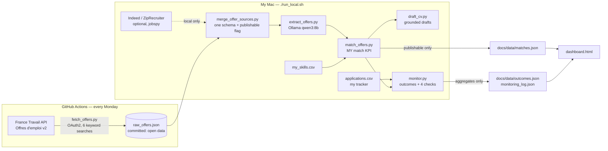

# Smart Internship Match

**Project 1 · Business Intelligence** — a personal decision-support system for my
end-of-studies internship search (6 months from March 2027, data science / ML / NLP /
IT audit): collect real offers, structure them, match them against my skills, help me
act, and track what happens.

### [Open the dashboard](https://adam-hassen-bi.github.io/smart-internship-match-TP1/dashboard.html)

https://adam-hassen-bi.github.io/smart-internship-match-TP1/dashboard.html ·
[raw data sanity check](https://adam-hassen-bi.github.io/smart-internship-match-TP1/)

AI is used only where it adds something — structuring free-text offers and drafting
a first cover-letter paragraph — and never to decide or to record what I did. The
application tracker is a plain table I fill in myself; the dashboard ranks, I decide.

---

## Pipeline



| Stage | Script | Runs | Output | In git? |
|---|---|---|---|---|
| Acquisition | `fetch_offers.py` | GitHub Actions, weekly | `data/offers/raw_offers.json` | yes — official open data |
| Optional 2nd source | `fetch_offers_jobspy.py` | laptop, by hand | `jobspy_offers.json` | **no** — scraped |
| Structuring | `merge_offer_sources.py` → `extract_offers.py` | laptop (Ollama) | `structured_offers.json` | **no** |
| KPI | `match_offers.py` | laptop | `matches_all_local.json` / `docs/data/matches.json` | local / **publishable only** |
| Action | `draft_cv.py` | laptop | `output/cv_drafts/` | **no** |
| Monitoring | `monitor.py` | laptop | `docs/data/outcomes.json`, `monitoring_log.json` | aggregates only |

## My match KPI (`score_offer`)

```
required   = extracted skills, normalized (case, spelling, FR/EN aliases), de-duplicated, soft skills removed
matched    = my profile skills found in required        gaps = required skills I don't have
coverage   = |matched| / |required|
score      = ( Σ level/5 over matched ) / |required|  ×  min(1, |required| / 3)
```

- **Normalization before matching**: the LLM returns `Python` in one offer and
  `python` in the next, `apprentissage automatique` instead of `Machine learning`. An
  exact string match would silently miss those; `skills.py` + the `aliases` column of
  `my_skills.csv` map every variant to one key.
- **Weighted by my level**: a match on a skill I rate 2/5 is worth less than on one I
  rate 5/5 — and `draft_cv.py` quotes the evidence of every matched skill, so it must
  be a skill I can back up.
- **Confidence discount**: an offer that names only "Python" would otherwise score
  100 % and rank above a detailed data-science offer where I cover 6 skills out of 8.
- **Threshold**: score ≥ 0.4 = "worth applying".

Extra KPI that is *not* "more applications, faster": **next skill to learn** — for
each missing skill, how many offers would cross the threshold if I reached level 3 in
it. It differs from the plain "most frequent gap" ranking, and it is the one to act on.

## Dashboard — KPIs in the three required categories

| Category | KPIs | Chart and why |
|---|---|---|
| **Search effectiveness** | offers worth applying to, match-score distribution, most frequent gaps, next skill to learn, strengths × level | ranked table (I act on exact titles and links), histogram (a distribution), ranked bars (comparison) |
| **Outcome** | applications sent, status split, response rate, positive rate, median days to answer, applications per week | one stacked status bar (parts of a whole at a glance), weekly bars (rhythm, gaps) |
| **Pipeline health** | offers per run, extraction errors, offers with no skill found, error rate from my own re-reading, experience / compensation stated, monitoring runs | small exact-figure tables |

## Monitoring (`monitor.py`)

Four checks, run after every local update and logged in `docs/data/monitoring_log.json`
(the dashboard lists every run):

1. **Stale** — application sent more than 10 days ago with no answer → follow up.
2. **Freshness** — France Travail fetch older than 8 days → the weekly workflow stopped.
3. **New match** — no new high-match offer since the previous check → widen keywords or region.
4. **Backlog** — high-match offers I have not applied to → review them.

## Privacy decisions

- Repository public (needed for GitHub Pages). My skills profile is public — it is what
  my CV already says.
- **My applications stay local**: `data/tracker/applications.csv` (company, title,
  dates, outcome) is git-ignored; only counts reach `outcomes.json`.
- Offers scraped with jobspy are marked `publishable: false` and never reach
  `docs/data/matches.json`; cover-letter drafts stay in `output/cv_drafts/`.
- France Travail credentials are GitHub **secrets**, never in the code.

## Run it

Once — repository secrets `FRANCETRAVAIL_CLIENT_ID` / `FRANCETRAVAIL_CLIENT_SECRET`
(from [francetravail.io](https://francetravail.io), API "Offres d'emploi v2"), Ollama
with `qwen3:8b`, and `cp data/tracker/applications.template.csv data/tracker/applications.csv`.

Every week:

```bash
./run_local.sh                 # pull Monday's offers, merge, extract, match, monitor
./run_local.sh --jobspy        # + Indeed / ZipRecruiter (local only)
./run_local.sh --drafts        # + cover-letter openings for the top 3 (local only)
git add docs/data/ && git commit -m "Update matches" && git push
python3 serve.py               # dashboard on http://localhost:8000/dashboard.html
```

To log a check of the model's output, add a line to `data/quality/critique_log.csv`
(`date, offer_id, field, skills_checked, errors, error_type, note`).

## Repository layout

```
.github/workflows/fetch_offers.yml   weekly France Travail fetch
data/profile/my_skills.csv           my skills: level 1-5, evidence, aliases
data/offers/raw_offers.json          fetched by the workflow
data/tracker/applications.template.csv   columns of my (local) tracker
data/quality/critique_log.csv        my manual checks of the LLM extraction
scripts/                             fetch, jobspy, merge, extract, skills, match, draft, monitor
docs/dashboard.html                  decision dashboard
docs/index.html                      raw-data sanity check
docs/data/                           matches.json, outcomes.json, monitoring_log.json
run_local.sh · serve.py
```

## Known limits

- Skill levels are self-assessed; a match means "the offer names a skill I list", not
  "I meet its level".
- France Travail has no "stage" contract type (a French internship is a *convention de
  stage*, not an employment contract): offers are found by keyword, so some results
  are not internships.
- Compensation is rarely stated in internship offers: reported as a count, not charted.
